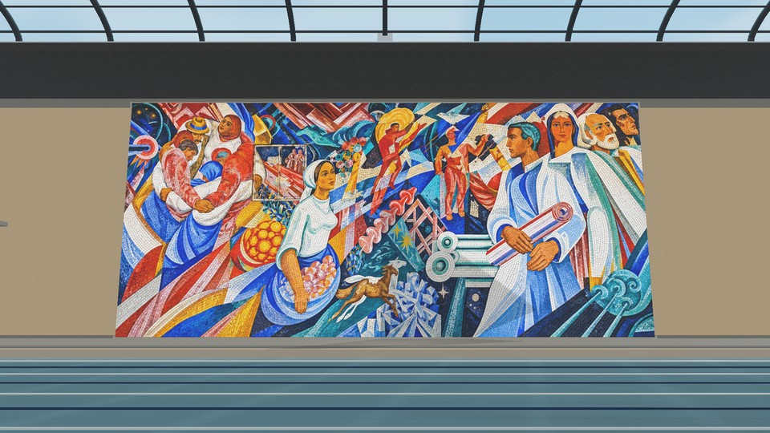
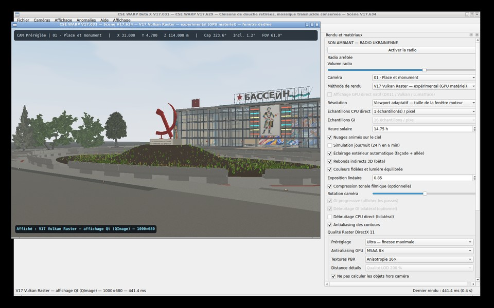
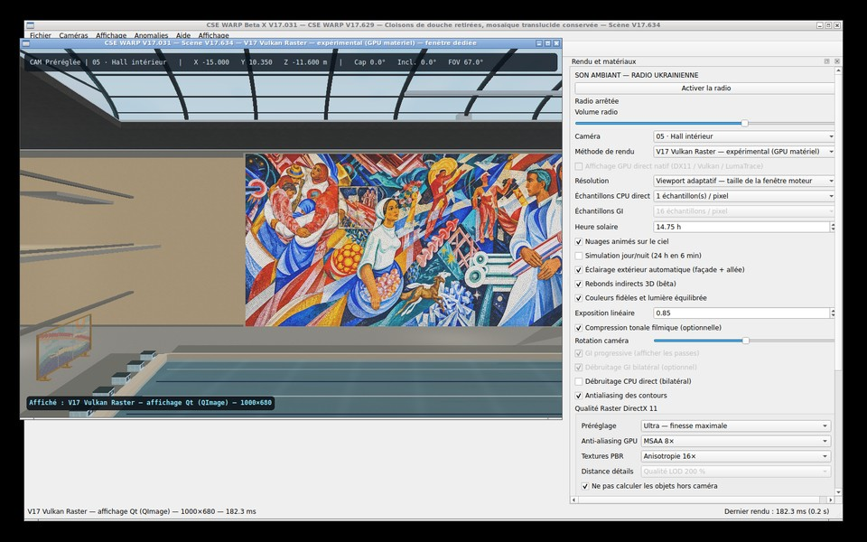

# Audit Linux — CSE WARP V17.031

28 novembre 2026. Référence master `2036130d88e9337c6e6aab057c6a63b71fe43a37`, [Build 11](https://github.com/glaby91/moteur3d/actions/runs/46129493787), scène V17.634. Audit documentaire et du backend, pas de compilation supplémentaire. [Historique Linux](../../v17/docs/LINUX_VULKAN.md) · [QA GUI détaillée](../../v17/docs/LINUX_GUI_QA.md) · [Vulkan 1.4 commun](VULKAN_14.md).

## État réel
| Domaine | État / preuve |
|---|---|
| Ubuntu 24.04 x86_64, Qt 6.8.3 | Build 11 moteur, SPIR-V, 5/5 tests et package réussis |
| API | Loader 1.3.275 ; Mesa llvmpipe/Lavapipe LLVM 20.1.2, API périphérique 1.4.318 ; demande moteur 1.3.204. Logiciel explicitement autorisé en CI, GPU physique non validé. |
| Rendu | Full HD piscine Build 6 : 457,683 et 467,494 ms pour 2 images chaudes, CPU PBR 9714,26 ms (techniques différentes). Build 11 : tests shader/raster et package, pas de nouveau parcours complet. |
| CPU | Build 6 Debian 13 : PBR direct et GI 4 rebonds 16 spp. |
| GUI | Build 8 Ubuntu Xvfb : 10 caméras ; navigation, FOV, plein écran, Pip-Boy, PNG. 26 processus terminés, sept contrôles fonctionnels FAIL et plusieurs SKIP. |
| Audio | Build 8 PCM réel vers sink PulseAudio virtuel, 48 kHz stéréo ; local fallback auto et stop/restart. Pas d'écoute physique ni flux live validés. |
| Présentation | QImage synchrone, X11/Wayland swapchain non portée ; DX11/LumaTrace GPU absents. |
| Distribution | [Package Build 11](https://github.com/glaby91/moteur3d/actions/runs/46129493787/artifacts/15257341811) et [diagnostics](https://github.com/glaby91/moteur3d/actions/runs/46129493787/artifacts/15257341817). Dépendances Vulkan/Qt/XCB/audio ; scène vérifiée incluse dans ce package Linux historique. |

Ne pas interpréter le texte générique « PASS Vulkan hardware GPU raster » du smoke comme preuve de GPU matériel : les logs identifient llvmpipe. Les différences de luminosité, ombres et eau restent à expliquer ; pas de parité visuelle CPU/DX11. La validation Khronos complète et GPU physique manquent.

## Reste à faire — ordre proposé
| ID | Priorité | Travail | Critère |
|---|---|---|---|
| LNX-01 | P0 | GPU Intel (HD620 si driver compatible), AMD RADV, NVIDIA propriétaire, Intel ANV ; versions/capacités/validation layers ; sélection de GPU explicite (code actuel préfère intégré, puis discret) | Tests sur GPU réel, pas de fallback logiciel silencieux ; rapport Vulkan 1.3 et 1.4 |
| LNX-02 | P1 | WSI Qt natif X11/XCB et Wayland, même raster et surface Qt compatible ; vérifier queue present, formats et gestion taille/DPI/fullscreen | Zéro readback image, resize/minimize/recreate correct, 30 min parcours réel ; secours QImage |
| LNX-03 | P1 | LNX-GUI-01 : presets Raster, MSAA, anisotropie, LOD adaptatif encore liés à DX11 | Chaque contrôle appliqué à Vulkan ou grisé avec motif ; valeurs effectives et sortie testées |
| LNX-04 | P1 | LNX-GUI-02 : lanceur GI bake cherche .exe | Binaire natif installé, chemin indépendant de plateforme, création/lecture table GI validée |
| LNX-05 | P1 | LNX-GUI-03/04 : caméra d'anomalie et ouverture scène secondaire | JSON round-trip, identité scène et frame fraîche ; diagnostiquer avant correction |
| LNX-06 | P1 | LNX-QA-01/02 : Full HD GUI ambigu, détail/frustum et benchmark non testés | Assertions dimensions réellement rendues, options supportées, parcours benchmark et export |
| LNX-07 | P1 | Rendu plus clair, ombres et eau ; validation GI et transparence | Rendus comparables paramètres égaux et anomalies isolées, aucune baisse qualité |
| LNX-08 | P2 | Audio réel PipeWire/PulseAudio, flux Internet et fallback local, boucle jour/nuit | Écoute et PCM, arrêt/redémarrage, pas de freeze |
| LNX-09 | P2 | Package autonome portable (AppImage/tar), Wayland, Debian/Ubuntu et installation propre | Dépendances, plugins QPA/audio/TLS, fonctionnement hors ligne vérifié |
| LNX-10 | P2 | Vulkan 1.4 : négociation, profils Intel/AMD/NVIDIA, host copy vs queue de transfert, push descriptors, sync2/timeline | [Protocole](VULKAN_14.md), aucun changement de minimum |

## Optimisations Linux à privilégier
1. Swapchain, suppression QImage sur présentation directe : bénéfice attendu à mesurer sur GPU réel. Pas une fonctionnalité exclusive 1.4.
2. Distinguer iGPU UMA et GPU discrets. Sur UMA tester host image copy et mémoire cohérente sans copie superflue ; sur discret tester staging persistants, transferts groupés et queue dédiée si disponible, ownership/barrières explicites. Vulkan 1.4 host copy facultatif et formats à contrôler.
3. Tester fusion plages de dessin/culling et BGRA indépendamment ; le bénéfice Mac ne se transpose pas automatiquement. Préserver ordre transparent et précision PBR.
4. Sync2/timeline (déjà 1.3) et plusieurs frames en vol après WSI ; cache pipeline et statistiques frame pacing. Ne pas supprimer les synchronisations nécessaires à une mutation de scène.
5. Push descriptors et local read : activer selon features, limites, formats, profondeur/MSAA ; garder chemins legacy. Mesurer GPU et CPU, pas seulement temps de soumission. Aucun gain FPS annoncé avant mesures.

## Galerie réelle

Build 6, Vulkan Lavapipe, source 1920×1080, caméra v7_pool_fresco, [PNG d'origine et JSON](https://github.com/glaby91/moteur3d/actions/runs/46083487533/artifacts/15237877283).

Build 8, captures du GUI Xvfb (fichiers source 1600×1000, ce n'est pas la résolution certifiée du rendu 3D) ; caméras 1 et 5, [originaux](https://github.com/glaby91/moteur3d/actions/runs/46088634614/artifacts/15239724092). Aperçus JPEG réduits pour le README, aucune génération artificielle.
