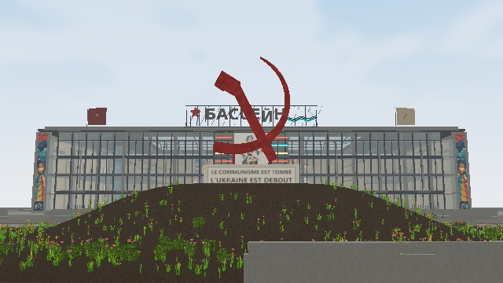
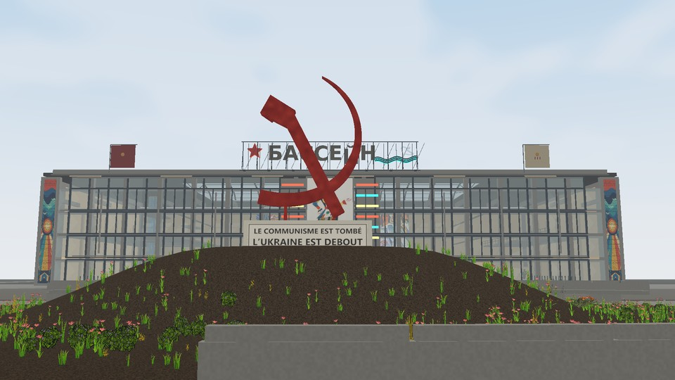

# Audit macOS — CSE WARP V17.031

28 novembre 2026. Référence de code master `2036130d88e9337c6e6aab057c6a63b71fe43a37`, [Build 11](https://github.com/glaby91/moteur3d/actions/runs/46129493750), scène V17.634. Audit documentaire et du backend ; pas de nouvelle exécution du moteur. Voir [historique du portage](../../v17/docs/MACOS_VULKAN.md), [optimisation 001](../../v17/docs/MACOS_VULKAN_OPT_001.md), [stratégie commune Vulkan 1.4](VULKAN_14.md).

## État réel
| Domaine | État / preuve |
|---|---|
| Compilation ARM64, Qt 6.10.3, SDK 1.4.363.1 | OK Build 11, shaders SPIR-V, moteur et outils ; 5/5 tests |
| API | Loader 1.4.363 ; GPU Apple Paravirtual device 1.3.357, MoltenVK 1.4.2. Minimum demandé 1.3.204. |
| Raster | Triangle et scène 640×360, deux profils, PNG, MSAA 1 ; hors écran CI. Full HD et déplacement hors écran démontrés au Build 7, pas une vraie fenêtre. |
| Navigation | Smoke Qt : commandes de marche/crouch/saut/Pip-Boy ; offscreen |
| Mémoire | Images optimales privées dédiées sur Apple ; conserver le correctif des crashes de liaison mémoire. GI RGBA32F et textures protégées préservées. |
| Présentation | QImage synchrone, pas de WSI Cocoa validé. |
| Package | [Build 11](https://github.com/glaby91/moteur3d/actions/runs/46129493750/artifacts/15256854128), développeur ARM64 ; dépendances locales, non signé/notarisé. |
| CPU et audio | ARM64 scalaire ; NEON non porté, CPU/GI et audio réel sur Mac non validés. |
| Autres backends | Compute DX11, LumaTrace GPU et Z Reflect non portés. Metal natif compute probe distinct, pas un backend raster Metal natif. |

Build 11 : 5/5 tests ; avertissements d'initialisation de structures Vulkan et API Qt dépréciées à traiter sans changer le rendu. Pas de garantie d'absence de VUID : validation layer et synchronisation n'ont pas été établies pour toute l'application. Les tests réussis ne prouvent ni fidélité CPU/DX11 ni performance sur Mac physique.

## Optimisations mesurées
- Build 7 : merge draws + BGRA, 1508 → 36 draws statiques, 288/288 images optimisées identiques ; Full HD mobile 23,34 → 22,22 ms (+5,0 % FPS équivalents). Options non activées par défaut.
- [Commands 002 Build 3](https://github.com/glaby91/moteur3d/actions/runs/46131903343) sur branche expérimentale, [artefact](https://github.com/glaby91/moteur3d/actions/runs/46131903343/artifacts/15258780407) : tous processus réussis ; aucun changement des defaults master. MSAA 1, médianes en ms :

| Profil | Fixe | Mobile | Images exactes | Cold ms |
|---|---:|---:|---:|---:|
| Référence | 25,131 | 22,811 | 48/48 | 3640 |
| Prefill | 23,058 | 22,642 | 48/48 | 2623 |
| Arguments off | 22,934 | 22,527 | 46/48 | 3401 |
| Timestamps off | 22,691 | 22,444 | 48/48 | 2251 |
| Mip barriers | 22,484 | 22,040 | 48/48 | 2336 |
| Batched uploads | 23,287 | 23,298 | 48/48 | 2035 |
| Async submit | 22,710 | 22,202 | 48/48 | 2501 |
| Transient | 23,257 | 22,695 | 48/48 | 2491 |
| Référence combinée | 23,003 | 22,592 | 48/48 | 2149 |
| Combiné | 23,177 | 22,719 | 48/48 | 2239 |

Le combiné (mip barriers + async submit + uploads) est pixel-exact mais légèrement plus lent que sa référence dédiée : ne pas promouvoir. Arguments off rejeté (2 divergences). MSAA 4 : transient non actif d'après logs ; résultat ne valide pas l'allocation transitoire MSAA. Async submit réduit la médiane submit mobile de 0,151 à 0,036 ms dans son essai ; attente GPU domine, pas de pipeline asynchrone multi-images validé. Les gains froid peuvent être sensibles au cache et à l'ordre des runs.

## Reste à faire — ordre proposé
| ID | Priorité | Travail | Critère d'acceptation |
|---|---|---|---|
| MAC-01 | P0 | GPU physique Apple M1/M2 et plus récent ; relever capacités et versions, validation layers, défauts GI/éclairage/rendu et pertes de device | Pas de crash, pas de nouvelle erreur, comparaison images/scène exacte |
| MAC-02 | P1 | WSI Cocoa/CAMetalLayer via Qt et VK_EXT_metal_surface ; intégrer le chemin swapchain commun, gérer main thread, Retina/DPI, fullscreen, resize, minimisation, fermeture, frame in flight | 30 min navigation, zéro readback image, fallback QImage explicite |
| MAC-03 | P1 | Audio natif local spatial et radio réseau, cache hors ligne ; vérifier device change et stop/restart | PCM stéréo réel, écoute physique, aucune saccade jour/nuit |
| MAC-04 | P1 | Bundle .app autonome, dylib Qt/MoltenVK, rpaths, plugins, signature/notarisation et installation propre | Lancement hors environnement développeur ; scène indépendante |
| MAC-05 | P1 | Valider vraie table GI, CPU PBR et GI 4 rebonds, couleurs, ombres et transparence | Rendus de référence, temps de préparation/mémoire documentés |
| MAC-06 | P2 | NEON ARM64 pour BVH/CPU et simulation des équivalences scalaires | Tests numérique/visuel, benchmark CPU ; chemin scalaire conservé |
| MAC-07 | P2 | Refaire tests mip barriers et async submit indépendamment sur GPU physique ; uploads groupés seulement si gain froid reproductible | 3+ répétitions, rendu exact, pas de régression p95 |
| MAC-08 | P2 | Vulkan 1.4 selon capacités ; host copy, push descriptors, local read après WSI | Appliquer [protocole](VULKAN_14.md), pas de dépendance obligatoire à 1.4 |

Priorité spécifique Apple : WSI et réduction des transferts, puis mémoire unifiée et tile rendering. Ne pas réintroduire l'allocation d'images qui avait provoqué les crashes ; host image copy et lectures locales seulement si le pilote expose les capacités et les formats. Une mise à jour MoltenVK doit être testée et épinglée. Le GPU CI n'expose pas actuellement Vulkan 1.4 complet.

## Galerie réelle (aperçus JPEG, non rendus générés)
Les originaux PNG sont dans les artefacts référencés ; la galerie réduit uniquement les dimensions et compresse pour éviter de gonfler le dépôt. Aucun changement de rendu.

Build 11, 640×360, profil optimisé du smoke (options du test, pas defaults), [diagnostics](https://github.com/glaby91/moteur3d/actions/runs/46129493750/artifacts/15257163190).

Build 7, source 1920×1080, profil combiné merge + BGRA, images 0 et 23, [originaux et métriques](https://github.com/glaby91/moteur3d/actions/runs/46095834402/artifacts/15243835709). GPU Apple paravirtualisé, hors écran.
